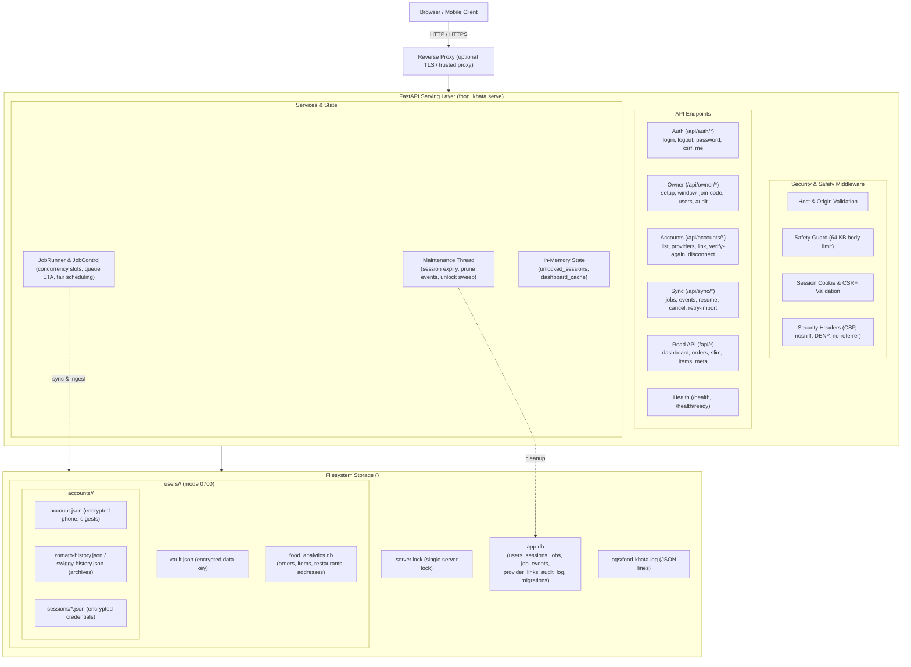
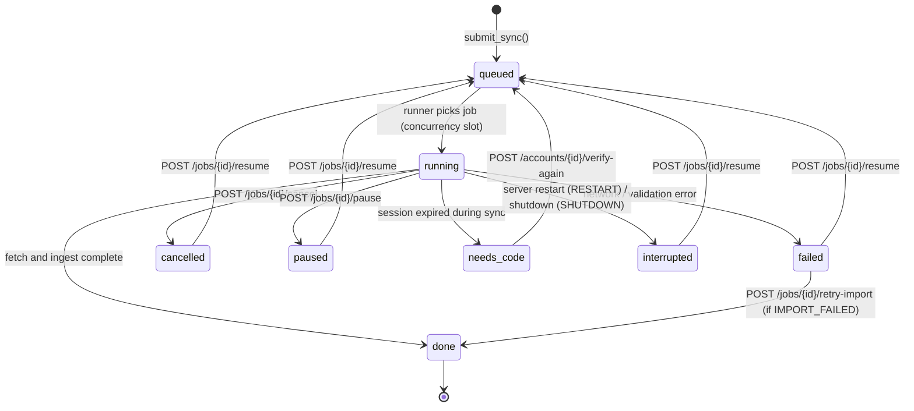

# Architecture and storage

`food_khata.py` and the installed CLI command invoke `food_khata.cli.main`.

## System Architecture



---

## Job State Lifecycle

Jobs represent background provider synchronization operations. Exactly one active job (running or queued) is permitted per `(account, provider)` tuple; attempting to submit or resume a second active job returns HTTP 409 (`ACCOUNT_BUSY`).



### Job States & Transitions
- **`queued`**: Awaiting an available provider execution slot. Queue exposes 1-based `queue_position` and calculated `eta_seconds`.
- **`running`**: Actively fetching order history and downloading missing details. Progress events update at most once per second.
- **`done`**: History and details downloaded and successfully ingested into the user's `food_analytics.db`.
- **`failed`**: Sync or ingestion failed. If the fetch completed but the SQLite import failed (`error_code="IMPORT_FAILED"`), `POST /api/sync/jobs/{id}/retry-import` reruns the import without contacting the provider.
- **`needs_code`**: Provider session expired during fetch. Completing `POST /api/accounts/{id}/verify-again` updates credentials and resumes the job back to `queued`.
- **`paused`**: Suspended by user.
- **`cancelled`**: Stopped by user request.
- **`interrupted`**: Interrupted by a server process event. On server startup, all previously active jobs become `interrupted` (`RESTART`). On graceful shutdown (SIGTERM), running jobs checkpoint and become `interrupted` (`SHUTDOWN`).
- **Resumption**: Jobs in `interrupted`, `failed`, `cancelled`, or `paused` state can be resumed back to `queued` via `POST /api/sync/jobs/{id}/resume`.

---

## Storage Layout

The application root directory (`--data-dir`, default `.food-khata/`) separates shared server administration from isolated per-user analytical storage:

```text
<data>/
  .server.lock            <-- Exclusive OS file lock (code 2 if locked)
  app.db                  <-- Global server database (WAL mode)
  logs/
    food-khata.log        <-- Structured JSON lines, redacted secrets (10 MB x 5)
  users/
    <user-id>/            <-- Directory per user (mode 0700)
      vault.json          <-- Encrypted data key wrapped by password via scrypt
      food_analytics.db   <-- SQLite relational analytics database
      accounts/
        <local-account-id>/
          account.json    <-- Encrypted phone metadata, SHA-256 provider digests
          zomato-history.json  <-- Plain JSON order and detail archive
          swiggy-history.json  <-- Plain JSON order and detail archive
          sessions/
            zomato.json   <-- ChaCha20-Poly1305 encrypted tokens
            swiggy.json   <-- ChaCha20-Poly1305 encrypted cookies
```

### Database Tables
- **`app.db`**:
  - `users`: User identity, scrypt password hashes, disabled state, ownership flag.
  - `sessions`: Ephemeral web sessions (cleared at server start), creation and activity timestamps.
  - `jobs`: Background sync execution records, status, phase, counts, error codes.
  - `job_events`: Audit timeline of sync execution events.
  - `provider_links`: Cross-user duplicate detection via SHA-256 digests (`identity_hash`).
  - `audit_log`: Append-only security audit log (logins, owner actions).
  - `schema_migrations`: Additive migration tracking versions.
  - `server_settings`, `failed_logins`, `registration_attempts`: Dynamic flags and rate throttles.
- **`food_analytics.db`** (per user):
  - `accounts`: Local account IDs mapped to phone suffix labels.
  - `orders`: Normalized orders (IST timestamps, amount, fees, taxes, discounts, savings, status).
  - `order_items`: Line items with inferred dietary classification (`is_veg`).
  - `restaurants`: Restaurant names, cities, localities.
  - `delivery_addresses`: Delivery locations and coordinates.
  - `archive_imports`: API-visible pagination and detail completeness flags.
  - `partial_import_receipts`: Checkpoints for partial import decisions.
  - `quarantine`: Malformed order records isolated during ingest.

---

## API Routes & Endpoints

All endpoints are registered under `food_khata.serve`:

### Authentication (`food_khata/serve/routes_auth.py` and `routes_owner.py`)
- `POST /api/owner/setup`: First claim endpoint for the instance owner. Loopback only or requires the `--lan` setup code. Returns 404 once claimed.
- `GET /api/auth/setup-status`: Check whether an owner has been established.
- `POST /api/auth/register`: Create user account. Requires an existing owner and either an active join code or an open registration window. Maximum 8 users.
- `POST /api/auth/login`: Authenticate with username and password; unlocks the user's encryption vault.
- `POST /api/auth/password`: Authenticated password change for the current user; re-wraps the vault data key.
- `POST /api/auth/logout`: Invalidate current session and remove in-memory vault key.
- `POST /api/auth/logout-all`: Invalidate all active sessions for current user.
- `GET /api/auth/csrf`: Retrieve CSRF token (also supplied in `food_khata_csrf` cookie).
- `GET /api/auth/me`: Current user profile, username, and role.

### Accounts (`food_khata/serve/routes_accounts.py`)
- `GET /api/accounts`: List linked accounts for the current user (returns one row per `(account, provider)`).
- `GET /api/accounts/providers`: List supported providers (`zomato`, `swiggy`, and `fake` if enabled).
- `POST /api/accounts/link/start`: Initiate provider OAuth / SMS OTP login.
- `POST /api/accounts/link/verify`: Complete OTP verification and bind account.
- `POST /api/accounts/{account_id}/verify-again`: Re-authenticate an expired session. Automatically resumes any `needs_code` sync jobs for the account.
- `DELETE /api/accounts/{account_id}` & `POST /api/accounts/{account_id}/disconnect`: Unlink provider account. Accepts `wipe_data=true` to delete local order archives and analytics rows.

### Synchronization (`food_khata/serve/routes_sync.py`)
- `POST /api/sync/jobs`: Create and enqueue a sync job (`mode`: `incremental`, `repair`, or `full`). Returns 409 if active job exists.
- `GET /api/sync/jobs`: List user sync jobs with status, progress, queue position, and ETA.
- `GET /api/sync/jobs/{job_id}`: Retrieve detailed job record.
- `GET /api/sync/jobs/{job_id}/events`: Retrieve event log for a job.
- `POST /api/sync/jobs/{job_id}/resume`: Resume a paused, interrupted, failed, or cancelled job back to `queued`.
- `POST /api/sync/jobs/{job_id}/cancel`: Cancel a queued or running job.
- `POST /api/sync/jobs/{job_id}/pause`: Pause an active job.
- `POST /api/sync/jobs/{job_id}/use-partial`: Ingest partially retrieved orders after sync failure.
- `POST /api/sync/jobs/{job_id}/discard-partial`: Discard uncommitted partial orders.
- `POST /api/sync/jobs/{job_id}/retry-import`: Re-run analytics ingestion for a job that failed with `IMPORT_FAILED`.
*(Note: No `/code` route exists; OTP verification is handled via `/api/accounts/link/verify` or `/verify-again`)*.

### Owner Administration (`food_khata/serve/routes_owner.py`)
- `GET /api/owner/status`: Instance status, user counts, and registration window state.
- `POST /api/owner/window`: Open (with timeout in seconds) or close the registration window.
- `POST /api/owner/join-code/rotate`: Generate a fresh rotated household join code.
- `GET /api/owner/users`: List registered users, disabled status, and roles.
- `POST /api/owner/users/{user_id}/disable`: Disable or re-enable a user account.
- `POST /api/owner/users/{user_id}/reset-password`: Set temporary password for user (wipes provider credentials).
- `POST /api/owner/users/{user_id}/remove`: Irrevocably delete user, database, and accounts (requires `owner_password`).
- `POST /api/owner/transfer`: Transfer instance ownership to another user.
- `GET /api/owner/audit`: Retrieve append-only audit trail entries.

### Read Analytics API (`food_khata/serve/app.py`)
- `POST /api/dashboard`: Financial and operational KPI aggregations. Accepts optional `sections` filter (`overview`, `spending`, `food`, `behavior`, `places`).
- `GET /api/orders`: Paginated order records with multi-dimensional filtering.
- `GET /api/orders/slim`: Fast, lightweight order list for client-side charts (capped at 5,000 orders).
- `GET /api/orders/{order_id}/bill`: Itemized bill breakdown and pricing for a single order.
- `GET /api/restaurants`: Top restaurant leaders by spend and frequency.
- `GET /api/items`: Top food item leaders by spend and quantity.
- `GET /api/meta/filters`: Available filter dimensions (cities, localities, cuisines, payment options).
- `GET /api/meta/data-health`: Reconciliation check, API coverage, and data completeness metrics.

### System & Health Probes (`food_khata/serve/app.py`)
- `GET /health`: Basic process liveness probe (`{"status": "ok"}`).
- `GET /health/ready`: Readiness probe verifying `app.db` access, migration completeness, and maintenance thread health (200 `ready`, 503 `not_ready`).

---

## Security Architecture

- **Session Authentication**: Browser session cookie (`session_id`) only; no bearer headers accepted. Cookie flags: `HttpOnly`, `SameSite=Lax`. `Secure` attribute is set when served over TLS or when `--behind-https-proxy` is passed.
- **CSRF Protection**: State-changing requests (`POST`, `PUT`, `PATCH`, `DELETE`) require an `x-csrf-token` header matching the `food_khata_csrf` cookie.
- **Reverse Proxy Support**: Client IP extraction for throttling uses `--trusted-proxy ADDR` to read `X-Forwarded-For`; untrusted client headers are ignored.
- **Security Headers**: All HTTP responses include `Content-Security-Policy` (`default-src 'self' ...`), `X-Content-Type-Options: nosniff`, `X-Frame-Options: DENY`, and `Referrer-Policy: no-referrer`.
- **Payload Limits**: Request bodies are capped at 64 KB (`MAX_BODY_BYTES`); larger payloads return HTTP 413.
- **Session Lifetimes**: 8-hour idle timeout and 7-day absolute lifetime. All sessions are cleared from `app.db` at server startup (re-authentication required after restart).
- **Passwords**: Enforces a minimum length of 10 characters. Hashes use scrypt with per-user salts.
- **Audit Logging**: Sensitive operations (logins, failed attempts, owner actions, account deletions) append to `audit_log` in `app.db` without logging passwords, tokens, or codes.
- **LAN Mode Security**: Running with `--lan` binds to `0.0.0.0` and prints a one-time 10-character setup code (valid 30 minutes). Non-loopback owner claims require this code. Five incorrect attempts within 10 minutes lock out the client IP with HTTP 429.

---

## Concurrency & Resource Control

- **Server Concurrency**: Exactly one server process may run against a given data directory at a time, enforced by an OS file lock (`<data>/.server.lock`). A second server process immediately exits with code 2.
- **Provider Concurrency**: Provider job concurrency is bounded per provider via `--provider-concurrency swiggy=1,zomato=1` (defaults to 1 slot each).
- **Per-User Limits**: At most 1 running job and 2 queued jobs per user at any time.
- **Read-Only Analytics Queries**: Analytics queries open SQLite in read-only mode (`?mode=ro`, `PRAGMA query_only=ON`) with busy timeouts, allowing concurrent reads while sync ingestion writes.

---

## Honest Limitations

1. **Unencrypted Archives and Analytics**: Provider credentials (`sessions/*.json`) and vault keys are encrypted with ChaCha20-Poly1305. Order archives (`*-history.json`) and analytical SQLite databases (`food_analytics.db`) are **not encrypted**.
2. **Host Administrator Access**: The host administrator or any process with read access to the server machine can read all data, memory keys, and SQLite records.
3. **Unofficial Provider APIs**: Provider APIs are undocumented, private mobile endpoints. Providers may change schemas, introduce rate limits, or block accounts without notice.
4. **Single Server Process**: Multi-server clustering against a shared data folder is unsupported; a single server lock is strictly required.

---

## Backup, Restore, and Export

- **Hot Backup**: `food-khata backup --out backup.tar.gz --data-dir <DIR>` safely captures all SQLite databases via SQLite's online backup API, archives, vaults, and a manifest with SHA-256 checksums while the server is live.
- **Safe Restore**: `food-khata restore backup.tar.gz --data-dir <EMPTY_DIR>` verifies every checksum against the manifest and extracts only into a clean, empty folder.
- **Offline JSON Export**: `food-khata export` dumps static aggregated analytics to `.food-khata/dashboard.json` (offline dashboard JSON, kept as a standalone export).
